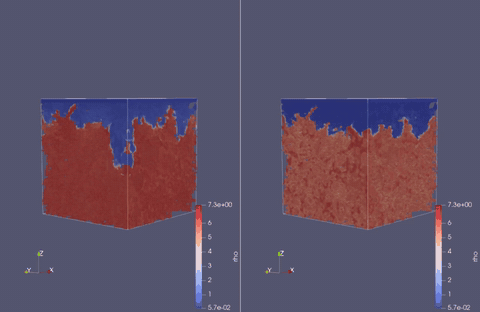

# Evaporation | 等温与非等温蒸发

本模块模拟三维孔隙内液态水蒸发及液–气界面变化，提供两种独立程序：等温模型保持温度恒定；非等温模型进一步考虑热量传递与温度变化。

非等温模型的顶部条件保持不变，底部可通过配置中的 `bottom_boundary_mode` 选择：

- `closed`：底部封闭，不补充液态水。
- `supplied`：底部设液相储层，允许外部补水。

## 下载与运行

| 模型 | EXE | 配置 | 启动 |
|---|---|---|---|
| 等温 | [SoilEvaporationLBM.exe](release/SoilEvaporationLBM.exe) | [config.txt](release/config.txt) | [run.bat](release/run.bat) |
| 非等温 | [SoilEvaporationLBM_NonIsothermal.exe](release/SoilEvaporationLBM_NonIsothermal.exe) | [config_nonisothermal.txt](release/config_nonisothermal.txt) | [run_nonisothermal.bat](release/run_nonisothermal.bat) |

1. 将所选模型的 EXE、TXT 和 BAT 放到同一目录。
2. 修改配置中的几何路径、初始液–气相态、网格尺寸、参数和输出目录。输入是按 X 索引变化最快顺序展开的纯文本数组。
3. 非等温计算按需要设置底部边界模式，确认顶部和底部温度设置。
4. 双击对应 BAT 启动，运行结果写入配置指定的输出目录。

程序可输出统计 CSV、三维场文件和断点文件；不同样品及底部边界模式的结果分别保存。断点仅用于匹配的原生 CUDA 版本。

运行需要兼容的 NVIDIA GPU。试用期为首次运行起连续 **72 小时**，与其他模块共享；运行前请检查输入网格与显存是否匹配。

## 计算示意与验证

[查看简要验证图](validation/README.md)。既有验证图反映研究阶段的基准测试，不代表所有新 CUDA 工况均已完成 GPU 数值复验。

[观看 MP4](media/representative_pore_scale_evaporation.mp4)
